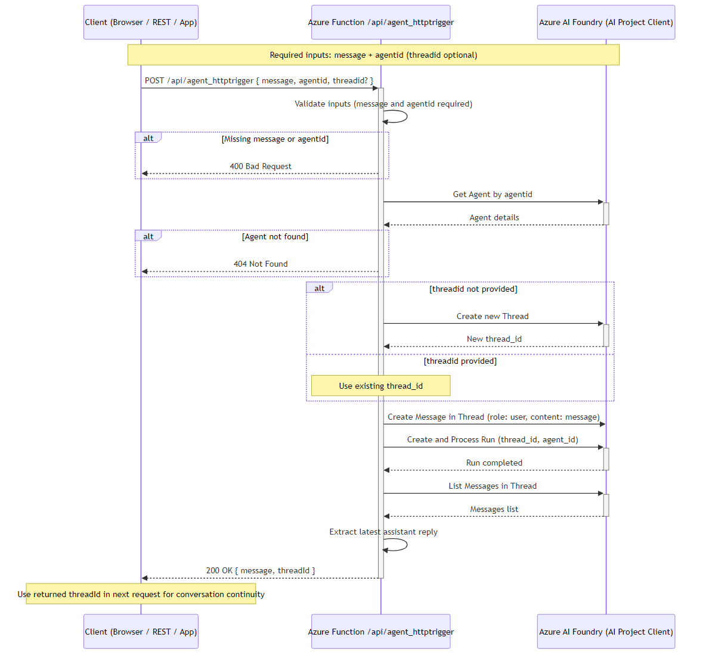

# azure-ai-foundry-agent

## Overview

The `azure-ai-foundry-agent` is a Python-based Azure Function application designed to interact with Azure AI Projects. It provides an HTTP-triggered endpoint for processing user messages and generating responses using AI agents.

This application is built to:
1. Handle user requests with message input.
2. Retrieve or create an AI agent thread.
3. Interact with the Azure AI Project API to process messages.
4. Generate responses based on AI agent capabilities.

## Features

- **HTTP Trigger**: Provides an anonymous endpoint `/agent_httptrigger` to accept user inputs.
- **Integration with Azure AI Projects**: Uses the `azure-ai-projects` library to manage AI agents, threads, and messages.
- **Error Handling**: Includes robust error checking and logging to ensure smooth operation.

## Prerequisites

To run this project, ensure that you have:
1. Azure Functions Core Tools installed.
2. Python 3.8 or later.
3. Required libraries listed in `requirements.txt`.
4. Azure Subscription to set up required resources like AI Projects.

## Installation

1. Clone the repository:
    ```bash
    git clone https://github.com/azure-data-ai-hub/azure-ai-foundry-agent.git
    cd azure-ai-foundry-agent
    ```

2. Install dependencies:
    ```bash
    pip install -r requirements.txt
    ```

3. Set up environment variables:
    - Add `AIProjectConnString` to your local settings or environment variables. This is crucial for connecting to Azure AI Projects.

4. Run the Azure Function locally:
    ```bash
    func start
    ```

## HTTP Trigger Details

### Endpoint

`POST /agent_httptrigger`

### Query Parameters

| Name       | Type   | Description                          |
|------------|--------|--------------------------------------|
| `message`  | string | The user message to process.         |
| `agentid`  | string | The ID of the AI agent.              |
| `threadid` | string | (Optional) The thread ID for context.|

### Request Example

```json
{
  "message": "Hello, AI Agent!",
  "agentid": "agent123",
  "threadid": "thread456"
}
```

## Architecture & Flow

The diagram below illustrates the end-to-end request flow when a client calls the Azure Function:



### Flow Summary

1. **Client sends a POST** with `message` + `agentid` (and optionally `threadid`).
2. The function **validates inputs**, then authenticates to Azure AI Foundry via `DefaultAzureCredential`.
3. It **retrieves the agent**, creates (or reuses) a conversation thread, posts the user message, and triggers a run.
4. The agent **processes the message** and the function extracts the latest assistant reply.
5. The response returns the AI-generated `message` plus the `threadId` — the client can pass this `threadId` back in subsequent requests to **maintain conversation continuity**.

## Environment Variables

Configure the following settings in `local.settings.json` (local development) or in your Azure Function App's **Application Settings** (deployed).

| Variable | Required | Description |
|---|---|---|
| `AIProjectEndpoint` | **Yes** | The endpoint URL for your Azure AI Foundry project (e.g. `https://<resource>.services.ai.azure.com/api/projects/<project>`). Used to authenticate and communicate with the AI Project Client. |
| `AGENT_ID` | **Yes** | The **name** of the Foundry agent that serves requests (not a GUID — the code calls `agents.get(agent_name=...)`). Callers cannot override it per request. |
| `ModelDeploymentName` | **Yes** | The name of your model deployment (e.g. `gpt-4o`), exactly as shown in the Foundry portal. Defaults to `gpt-5.5`, which is unlikely to match your deployment. |
| `FUNCTIONS_WORKER_RUNTIME` | **Yes** | Must be set to `python`. Tells the Azure Functions host which language runtime to use. |
| `AzureWebJobsStorage` | **Yes** | Connection string for the Azure Storage account used by the Functions host. Use `UseDevelopmentStorage=true` for local development with Azurite. |
| `APPLICATIONINSIGHTS_CONNECTION_STRING` | Recommended | Enables `track_event` custom events. Without it, telemetry degrades to plain traces and the KQL dashboards return nothing. |
| `MAX_CONVERSATION_TURNS` | Recommended | Caps conversation history before the model context window overflows. Default `8`; set `0` to disable. |
| `REQUIRE_USER_ID` | Recommended | When `true`, calls without an authenticated `user_id` return `400`. Enable once the Copilot Studio identity inputs use *Custom value*. See [IDENTITY_SPOOFING_HARDENING.md](./IDENTITY_SPOOFING_HARDENING.md). |
| `IDENTITY_GUARD_MODE` | No | Leave unset. Defaults to `enforce`, which refuses chat text that asserts another identity (e.g. `userid:XYZ`). `monitor` only logs it and does **not** protect the request; use it briefly during rollout, then remove it. Any other value enforces. |
| `AGENT_INSTRUCTIONS_TEMPLATE` | No | A template string for the agent's system instructions. Placeholders such as `{user_id}` and `{user_full_name}` are filled from the request's `parameters` object, which the Copilot Studio flow sends. A placeholder with no matching key returns `400`. |
| `AzureWebJobsFeatureFlags` | No | `EnableWorkerIndexing` was required by older runtimes. The Python v2 model is the default on current runtimes. |

> For the full list of environment variables (including those used by `send_hr_email` and
> `send_hr_answer`) and step-by-step provisioning, see
> [FOUNDRY_SETUP_CHECKLIST.md](./FOUNDRY_SETUP_CHECKLIST.md).

### Authentication

The function uses `DefaultAzureCredential` from the `azure-identity` SDK, which automatically picks up credentials from (in order):

1. **Environment variables** (`AZURE_CLIENT_ID`, `AZURE_TENANT_ID`, `AZURE_CLIENT_SECRET`)
2. **Managed Identity** (when deployed to Azure)
3. **Azure CLI / VS Code** (for local development)

No API keys are passed in code. Grant the Function App's managed identity the
**Foundry Agent Consumer** role on the Foundry resource — this is the least-privilege role
that can call agent endpoints.

> ⚠️ **`Owner` and `Contributor` do not work.** Per Microsoft's
> [hosted agent permissions reference](https://learn.microsoft.com/azure/foundry/agents/concepts/hosted-agent-permissions),
> neither role can interact with agent endpoints. Use **Foundry Agent Consumer** (or
> **Foundry User** if the identity also needs to create or modify agents). These roles were
> recently renamed — **Foundry User** was previously **Azure AI User** — so the portal may
> still show older names.
